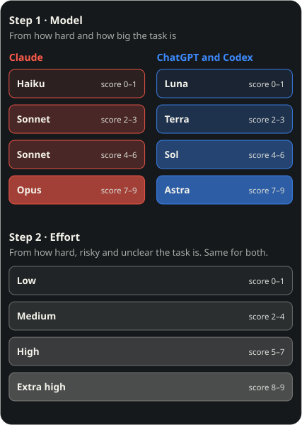

<p align="center">
  
</p>

<h1 align="center">Prompt Master</h1>

<p align="center"><b>Turn a rough prompt into a clear one, and get a model and effort recommendation.</b><br>One skill, two editions: Claude, and ChatGPT/Codex.</p>

<p align="center">
  <a href="LICENSE"></a>
  <a href="#claude-edition"></a>
  <a href="#chatgpt-edition"></a>
</p>

<p align="center"><a href="#pick-your-install">Install</a> · <a href="#commands">Commands</a> · <a href="#models-it-recommends">Models</a> · <a href="#good-to-know">Good to know</a></p>

https://github.com/user-attachments/assets/27a8a5e7-c70a-47d0-95b8-8ed3b9e2f5e4

## Pick your install

The two editions have the same commands. Download the one you use, or both.

| You use | Do this | Details |
| --- | --- | --- |
| Claude chat and Claude Code | Add it from the Claude directory, or download [`prompt-master-claude.zip`](claude/prompt-master-claude.zip) and upload it in **Settings → Skills**. Claude Code gets either automatically, or install it from the [terminal](docs/terminal-install.md) | [Install](#install-claude-and-claude-code) · [Claude Code](#using-claude-code) |
| ChatGPT and ChatGPT Work | Download [`prompt-master-chatgpt.zip`](chatgpt/prompt-master-chatgpt.zip) and upload it in **Skills → Create** | [Install](#install-chatgpt-and-chatgpt-work) |
| Codex | Run `$skill-installer`, or [link the repo](docs/terminal-install.md) to stay up to date | [Install](#install-codex) |

Commands on this page are for Mac and Linux. Windows (PowerShell) versions are in [Terminal install](docs/terminal-install.md).

> [!TIP]
> **Check it works:** start a new chat or session and type `pm help`. It shows every command with examples, so use it any time you forget one. An existing chat keeps the instructions it already loaded.

<br>

<p align="center"></p>

## Commands

| You type | You get |
| --- | --- |
| `pm: <rough prompt>` | A rewritten prompt, then the answer to it |
| `pm only: <rough prompt>` | Only the rewritten prompt, in a copy-ready block |
| `pm pick: <rough prompt>` | The rewrite, then a model and effort recommendation for it (no answer) |
| `ep: <task>` | A model and effort recommendation for the task as you wrote it |
| `ep claude: <task>` | Claude edition only: the same, plus a short Claude Code plan, plan mode and subagent advice |
| `ep codex: <task>` | ChatGPT edition only: the same, plus a short Codex plan and subagent advice |
| `pm code:` `pm email:` `pm study:` `pm research:` | A preset that shapes the rewrite for that kind of task. Combine them: `pm only email:`, `pm pick code:` |
| `pm critique: <rough prompt>` | A score out of 10, what's missing, and the one fix to make first (no rewrite) |
| `pm why` | What changed in the last rewrite and why |
| `pm again` / `pm undo` | A fresh rewrite, or an answer to your original draft as typed |
| **`pm help`** | **The full command list with examples. Use it whenever you forget a command.** |

Typing is case-insensitive. If key details are missing (numbers, an attached file, a vague goal), it asks up to three quick questions first, and **go** accepts its suggestions. `pm only:`, `pm pick:` and the `ep` commands never ask: they use `[placeholders]` instead.

### What the presets add

- **code:** language, your code and the exact error, expected vs actual behavior, constraints, output format, how to tell it works.
- **email:** who it's to, the goal, key points, tone, length, the one action you want, a deadline, subject line plus body.
- **study:** your level, topic and goal, time available, teaching from scratch with simple examples, practice questions, a check of understanding.
- **research:** the exact question, scope and time frame, depth, sources, facts kept separate from guesses, uncertainty stated.

<p align="center"></p>

## Claude edition

<a href="claude/prompt-master-claude.zip"></a>

### Install (Claude and Claude Code)

> [!WARNING]
> **Only choose one option.** Installing both shows Prompt Master twice.

**Option 1: add it from the Claude directory**

1. In Claude on the web or the desktop app, open **Customize** in the left sidebar, then **Plugins**, then **Discover**.
2. Search for **Prompt Master**, open it, check that the author is **Nishkarsh Shah**, and click **Add**.

On Team and Enterprise plans, an owner may need to allow plugins first.

**Option 2: upload the zip** (web, desktop and mobile apps)

1. Download [`prompt-master-claude.zip`](claude/prompt-master-claude.zip): open the file on GitHub and click the download button.
2. In Claude, open **Settings → Capabilities** and turn on **Code execution and file creation**. On Team and Enterprise plans, an admin may need to allow skills first.
3. Under **Skills**, choose **Upload skill**, pick the zip, and make sure its toggle is on.

### Using Claude Code

- **Signed in with the same Claude account:** Prompt Master appears there automatically, in the desktop app and in the terminal. A zip upload also runs as `/prompt-master`.
- **Using an API key, or want it without Claude chat:** use the [terminal install](docs/terminal-install.md).

Installed? Try the [commands](#commands) next, or type `pm help`.

<br>

## ChatGPT edition

<a href="chatgpt/prompt-master-chatgpt.zip"></a>

### Install (ChatGPT and ChatGPT Work)

1. Download [`prompt-master-chatgpt.zip`](chatgpt/prompt-master-chatgpt.zip): open the file on GitHub and click the download button.
2. In ChatGPT, open **Skills**, choose **Create**, then **Upload from your computer**, and pick the zip. On workspace plans, an admin may need to allow skill uploads first.

### Install (Codex)

In Codex, type:

```text
$skill-installer install https://github.com/nishkarsh-shah/prompt-master/tree/main/chatgpt/prompt-master
```

This puts the skill in `~/.agents/skills/prompt-master`. Restart Codex if `pm help` doesn't respond. To update, delete that folder and run the install command again.

Installed? Try the [commands](#commands) next, or type `pm help`.

<p align="center"></p>

## Models it recommends

The picker scores how hard, broad, risky and vague the task is. It only recommends the top models or max effort when the score earns it. Each bar shows the score range for that model. The picker is a rule of thumb, not a tested algorithm, and each column is its own ladder: rows show similar difficulty, not equal models.



<details>
<summary>The same list as a table</summary>

| Task | Claude | ChatGPT and Codex |
| --- | --- | --- |
| Lookups, formatting, simple questions | Haiku · low | GPT-5.6 Luna · low |
| Small clear edits and answers | Sonnet · low | GPT-5.6 Terra · low |
| Routine work | Sonnet · medium | GPT-5.6 Sol · medium |
| Multi-file work with a clear goal | Opus · medium | GPT-6 Sol · high |
| Hard debugging, design, subtle trade-offs | Opus · high | GPT-6.1 Sol · high |
| Deep architecture, security | Opus · max | GPT-6 Astra · high |

</details>

- **Claude:** a mechanical change to one file or item, such as a rename or a typo fix, always gets Haiku · low.
- **ChatGPT and Codex:** it adds a fallback in case your selector lacks the first pick, and stays on 5.6 until a task needs 6.x, which uses far more of your limits. A light but risky or unclear task steps up within the same family.

<p align="center"></p>

## Good to know

| Topic | What to know |
| --- | --- |
| **Updating** | An uploaded skill doesn't pull changes from GitHub. Download the new zip and upload it again. Directory installs update when a new version is published. Terminal installs update with the command on the [terminal install page](docs/terminal-install.md). |
| **Follow-ups** | After a `pm:` answer, Claude ends with a line telling you to type `pm again`, `pm why` or `pm undo`. ChatGPT shows them as buttons where the app supports native action buttons. Where there are none, such as Codex, type them. |
| **Capital letters** | `pm:` and `Pm:` both work, since phone keyboards capitalize the first letter. All-caps `PM:` and `EP:` are ignored, so notes like "PM: standup" don't start it. |
| **Plain asks** | In Claude, asking "improve this prompt" or "which model should I use for this?" without typing `pm` also works. It runs `pm only:` or `ep:` and adds a tip to type `pm:` next time. |
| **Advice only** | The skill never switches models or starts subagents for you. `ep claude:` and `ep codex:` only suggest a plan. Pick the model yourself, and in Claude use the extended thinking toggle for medium effort and above. |
| **Your plan** | On a Free plan it never recommends a paid-only model. The Claude edition is tuned for Pro and Max, and on pay-per-token API it leans cheaper when the stakes are low. |
| **Privacy** | Prompt Master doesn't collect, store or send any data. The skill is told to replace passwords, API keys and card or ID numbers with `[redacted]` in the rewrite, but don't paste real secrets: the AI provider has already received your text. See the [privacy policy](claude/plugin/PRIVACY.md). |
| **Language** | The rewrite uses the same language as your draft. |

Want to change what it recommends, or add a preset? See [Customize](docs/customize.md).

## Credits

Both editions were built by Nishkarsh Shah with Claude.

A community edition for Muse, built on this project, is available in [MaximusMaxxx’s fork](https://github.com/MaximusMaxxx/prompt-master-muse/tree/c5e413d/muse/prompt-master). I haven’t tested or reviewed it.

## License

MIT. See [LICENSE](LICENSE).
