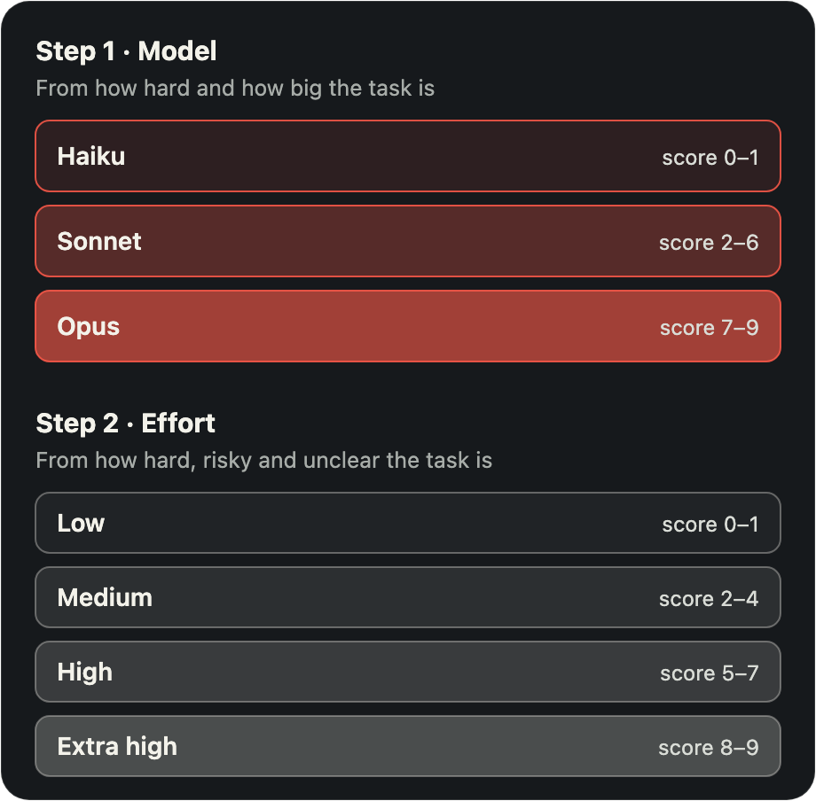

# Prompt Master

**Rough prompt in, clear prompt out, plus a suggested model and effort level to run it.**

Type `pm:` before a rough prompt. Prompt Master rewrites it into a clearer one, shows you the rewrite, and answers it. Type `ep:` before a task to find out which Claude model and effort level to use, without doing the task.

New to these words? The **model** is which Claude answers: Haiku, Sonnet or Opus, from lightest to strongest. The **effort level** is how hard it thinks before replying: low, medium, high, extra high or max.

## Start here

1. Open a new chat after installing. An older chat keeps the instructions it already loaded. In Claude Code, start a new session or run `/reload-plugins`.
2. Type `pm help` to see every command with examples.
3. Type `pm:` before a rough prompt, like the example below. `Pm:` works too.

In Claude Code you can also run it by name with `/prompt-master:prompt-master`.

## See it work

You type:

```text
pm: help me write a message asking my landlord to fix the heater
```

It rewrites your prompt:

> Write a message to my landlord asking them to fix the heater in [my unit/address]. Briefly describe the problem: [what's wrong with the heater and since when]. Ask them to arrange a repair by [date] and to confirm a time that works. Keep the tone polite but firm, and short enough to send as a text or email.

Then it answers that clearer prompt. Details you didn't give become `[placeholders]` instead of guesses.

## Commands

- `pm: <rough prompt>` gives a rewritten prompt, then the answer to it.
- `pm only: <rough prompt>` gives only the rewritten prompt, in a copy-ready block.
- `pm pick: <rough prompt>` gives the rewrite, then a model and effort recommendation for it.
- `ep: <task>` gives a model and effort recommendation for the task as you wrote it.
- `ep claude: <task>` gives the same, plus a short Claude Code plan, plan mode and subagent advice.
- `pm code:`, `pm email:`, `pm study:` and `pm research:` are presets that shape the rewrite for that kind of task.
- `pm critique: <rough prompt>` gives a score out of 10, what's missing, and the one fix to make first.
- `pm help` lists every command, with examples.

You can also ask in plain words, such as "improve this prompt" or "which model should I use for this?".

## Which model it suggests

The picker scores how hard, broad, risky and vague the task is. Then it picks the model and the effort in two separate steps, so any model can pair with any effort. It only suggests: you choose the model and effort yourself.



## What it contains

This plugin contains one skill, `skills/prompt-master/SKILL.md`. It is a set of instructions only: it has no scripts, hooks or MCP servers, and it doesn't fetch or send anything. The two images on this page are bundled with the plugin.

## Privacy

Prompt Master doesn't collect, store or send any data. It works only on the text you type in the chat. Full details: [PRIVACY.md](PRIVACY.md).

## More

Full documentation and other install options: https://github.com/nishkarsh-shah/prompt-master

MIT licensed.
